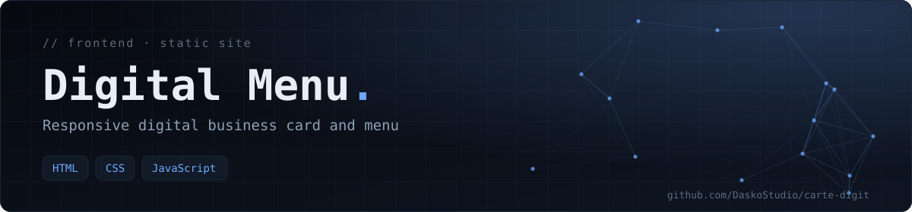

<div align="center">



**A responsive single-page website that works as a digital business card or menu, meant to be shared with a link or a QR code. Plain HTML, CSS and JavaScript — no build step.**

  

[Overview](#-overview) · [Features](#-features) · [Getting started](#-getting-started) · [Tech stack](#-tech-stack)

</div>

## 📖 Overview

This project (code name **ADK**) is a lightweight digital menu: one page, a logo, visuals and a clean layout that reads well on a phone, which is where it will mostly be opened after scanning a QR code.

## ✨ Features

- Single responsive page (`index.html`).
- Dedicated stylesheet (`style.css`) and interactions (`script.js`).
- Logo and visuals bundled with the page.
- Zero dependencies and zero build step — it can be hosted on any static host.

## 🚀 Getting started

Open `index.html` in a browser, or serve the folder locally:

```bash
python3 -m http.server 8000
# then open http://localhost:8000
```

## 🗂️ Project structure

```text
index.html    The page
style.css     Layout and styling
script.js     Interactions
*.png/jpg/webp/avif   Logo and visuals
```

## ☁️ Deployment

Any static host works (GitHub Pages, Vercel, Netlify): publish the repository root and share the resulting URL, or generate a QR code that points to it.

## 🧰 Tech stack

HTML · CSS · JavaScript

---

<div align="center">

<sub>Built by <a href="https://github.com/DaskoStudio"><b>Konaté Adama</b></a> · <a href="https://github.com/DaskoStudio?tab=repositories">More projects</a></sub>

</div>
